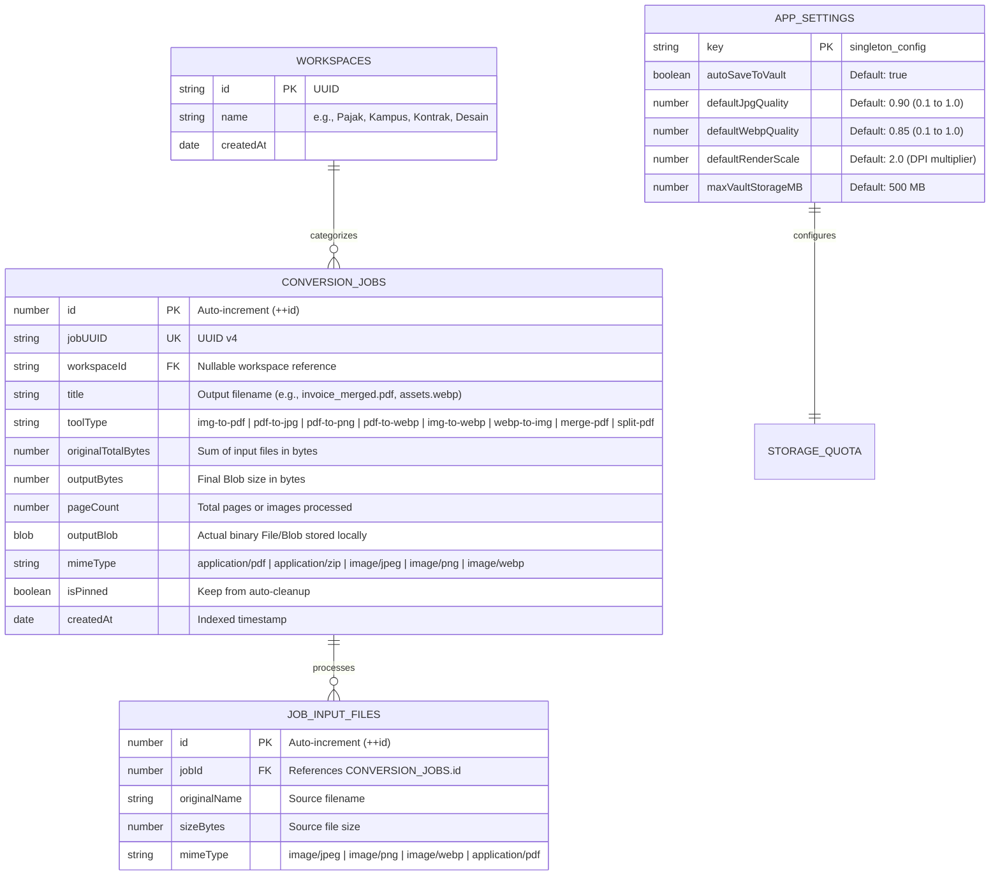

# ERD.md — Local Internal Database Architecture (Dexie.js / IndexedDB)

## 1. Storage Philosophy
This application has **no cloud backend**. Each user's device acts as its own isolated database server using browser-native `IndexedDB` managed via **Dexie.js**. Binary files (`Blob` / `ArrayBuffer`)—including `.pdf`, `.jpg`, `.png`, `.webp`, and `.zip` archives—are stored directly inside object stores without Base64 string conversion overhead.

## 2. Entity Relationship Diagram



## 3. Dexie.js TypeScript Implementation Specification

```typescript
import Dexie, { type Table } from 'dexie';

export type ToolType = 
  | 'img-to-pdf' 
  | 'pdf-to-jpg' 
  | 'pdf-to-png' 
  | 'pdf-to-webp'
  | 'img-to-webp'
  | 'webp-to-img'
  | 'merge-pdf' 
  | 'split-pdf';

export type SupportedMimeType =
  | 'application/pdf'
  | 'application/zip'
  | 'image/jpeg'
  | 'image/png'
  | 'image/webp';

export interface ConversionJob {
  id?: number;
  jobUUID: string;
  workspaceId?: string;
  title: string;
  toolType: ToolType;
  originalTotalBytes: number;
  outputBytes: number;
  pageCount: number;
  outputBlob: Blob;
  mimeType: SupportedMimeType;
  isPinned: boolean;
  createdAt: Date;
}

export interface JobInputFile {
  id?: number;
  jobId: number;
  originalName: string;
  sizeBytes: number;
  mimeType: string;
}

export interface AppSetting {
  key: 'singleton_config';
  autoSaveToVault: boolean;
  defaultJpgQuality: number;
  defaultWebpQuality: number;
  defaultRenderScale: number;
  maxVaultStorageMB: number;
}

export class LocalVaultDB extends Dexie {
  conversionJobs!: Table<ConversionJob, number>;
  jobInputFiles!: Table<JobInputFile, number>;
  appSettings!: Table<AppSetting, string>;

  constructor() {
    super('LocalVaultConverterDB');
    this.version(1).stores({
      conversionJobs: '++id, &jobUUID, workspaceId, toolType, isPinned, createdAt',
      jobInputFiles: '++id, jobId',
      appSettings: 'key'
    });
  }
}

export const db = new LocalVaultDB();
```

## 4. Cascade Deletion & Quota Rules
1. When a record in `conversionJobs` is deleted, all associated rows in `jobInputFiles` with matching `jobId` MUST be deleted inside a single Dexie transaction.
2. Querying the history list UI MUST omit reading `outputBlob` into memory until the user clicks **Download** or **Preview**, keeping list rendering instantaneous.